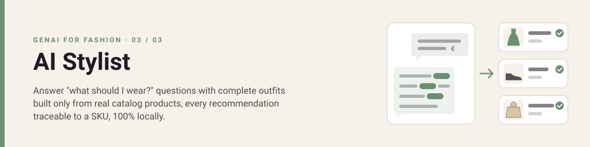
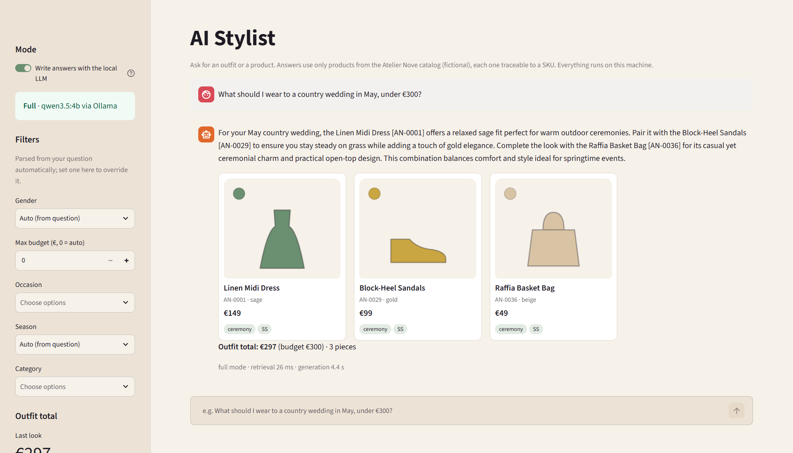
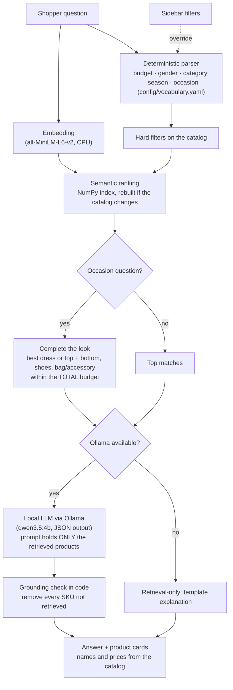
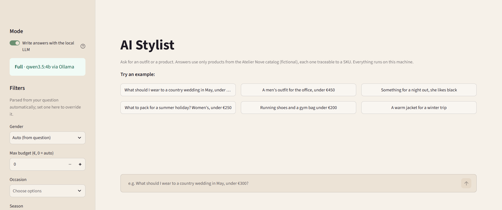
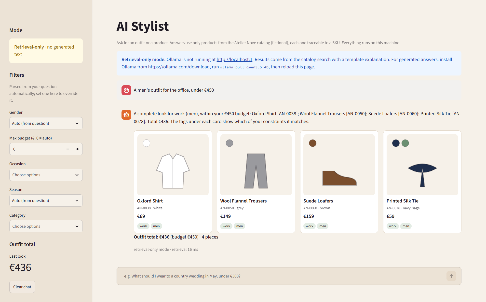

<p align="center">
  
</p>

# AI Stylist

**A conversational stylist that answers "what should I wear?" with complete outfits built only from real catalog products, every recommendation traceable to a SKU and checked in code, running 100% locally.**

[](https://github.com/tortonef/ai-stylist-rag/actions/workflows/ci.yml)

[](LICENSE)


## In 30 seconds

Ask *"What should I wear to a country wedding in May, under €300?"* and the app reads the hard constraints with plain rules (occasion, season, budget, gender, category), searches a 79-product sample catalog, and assembles the best complete look that fits the **total** budget. A small open model running on your machine then explains the outfit, citing every product by SKU; code removes any SKU that was not retrieved, and prices always come from the catalog, never from the model.
On 16 evaluation questions, **95% of the products shown meet every constraint, every outfit stays within budget, and no invented product reaches the shopper**. Without the model, the app still works in retrieval-only mode.

<p align="center"></p>

## The business problem

Shoppers rarely arrive with a SKU in mind. They arrive with an occasion: a wedding, a first week at a new job, a weekend away. Going from that need to a complete outfit means browsing several categories, filtering each one and adding up prices. Many give up, or buy one piece and leave the rest of the basket empty.

Generic chatbots look like the answer but **invent products, prices and availability**, and one wrong promise costs more trust than the chat earns. Brands need conversational selling that only ever talks about what they actually sell, respects the shopper's budget and can be audited.

**Who feels it:** e-commerce and digital teams (conversion, basket size), customer service (styling questions by chat and email), merchandisers (cross-category sell-through). The end users are shoppers.

## Business value

| | Before (filters and category pages) | After (grounded stylist) |
|---|---|---|
| From occasion to outfit | Shopper browses 3–4 categories and adds up prices | One question, one complete look within the stated budget |
| Basket size | One item per visit is common | Complete the look proposes 3–4 coordinated pieces |
| Trust | Generic chatbots can name products or prices that do not exist | Every product shown exists, was retrieved for this question and carries its catalog price |
| Customer service | Styling questions answered by hand | Answered instantly; agents handle what the stylist cannot |
| Returns from wrong expectations | Shopper guesses fit for the occasion | The answer says why each piece suits the occasion and season |

**Example, with illustrative assumptions:** 20,000 assisted sessions per month × 1 percentage point more conversion × €150 average order ≈ **€30,000 extra revenue per month**, before any basket-size effect.

Assumptions behind these figures (replace them with your own data):
- 20,000 sessions per month that use the stylist, +1 point of conversion and a €150 order value are **examples, not measurements**. Measure them with an A/B test against the current site.
- The basket-size effect depends on how often shoppers accept the full look; this demo has no data on that.
- Fewer returns and fewer service tickets are plausible but unquantified here.
- Results from a 79-product sample catalog do not transfer automatically to a real assortment of thousands of SKUs.

## How it works



Design choices:
- **Hard constraints are rules, not model guesses.** Budget, gender, category, season and occasion are parsed with readable rules (the occasion synonyms follow a fixed map, e.g. "wedding" → `ceremony`, "dinner" → `evening`). A filter either holds or it does not, and it can be tested. The sidebar lets the shopper override any of them.
- **Grounding is enforced in code.** The model sees only the products retrieved for this question and must cite them as `[AN-0001]`. Any other SKU, even one that exists in the catalog, is removed from the answer and reported. Prices are not in the prompt at all; the cards show them from the catalog.
- **The outfit is chosen by search, not by the model.** Complete the look tries the 5 best candidates per slot exhaustively (a few hundred combinations, milliseconds) and keeps the best-matching look under the total budget. When no look fits, the app says so and shows individual items instead.
- **Local and privacy-first.** Embeddings and the LLM run on your machine; questions are never sent anywhere. The app listens on `localhost` only and works offline after setup.
- **Works without the LLM.** If Ollama is missing or stopped, the app switches to retrieval-only mode with a banner: same search, same looks, a template explanation, answers in milliseconds.

## Quickstart

**Requirements:** Python 3.12, 8 GB RAM, about 6 GB of free disk. [Ollama](https://ollama.com/download) for generated answers (optional: without it the app runs in retrieval-only mode). No GPU, no accounts, no API keys.
The first setup downloads about 3.6 GB (PyTorch CPU, the 90 MB embedding model and the 3.3 GB LLM) and takes 10–20 minutes depending on your connection.

**Windows (PowerShell)**
```powershell
git clone https://github.com/tortonef/ai-stylist-rag.git; cd ai-stylist-rag
powershell -ExecutionPolicy Bypass -File .\setup.ps1
powershell -ExecutionPolicy Bypass -File .\run.ps1
```

**macOS / Linux**
```bash
git clone https://github.com/tortonef/ai-stylist-rag.git && cd ai-stylist-rag
bash setup.sh
bash run.sh
```

The app opens at <http://localhost:8501>.

<details>
<summary>Troubleshooting</summary>

- **"running scripts is disabled on this system"**: use the `powershell -ExecutionPolicy Bypass -File ...` form above; it does not change any system setting.
- **Python 3.12 not found**: install it from [python.org](https://www.python.org/downloads/). On Windows the setup uses the `py -3.12` launcher, which the installer adds by default.
- **"Ollama not found" during setup**: the setup still completes and the app opens in retrieval-only mode. For generated answers install Ollama (Windows: `winget install --id Ollama.Ollama -e`), open a new terminal and run the setup again.
- **Retrieval-only banner although Ollama is installed**: start the Ollama app (or `ollama serve`) and reload the page.
- **"Model not found" when the app starts**: run the setup script again; it resumes the download.
- **Generated answers are slow**: on a laptop without a GPU expect 20–25 seconds per answer. Turn off "Write answers with the local LLM" in the sidebar for instant retrieval-only answers.
- The setup is safe to run more than once.
</details>

## Using it

1. **Ask, or click an example.** Six example questions cover weddings, the office, a night out, holidays, sport and outerwear. You can also link straight to a question: `http://localhost:8501/?q=linen+shirt+for+him`.

<p align="center"></p>

2. **Read the answer and the cards** (screenshot at the top). Each card shows the thumbnail, name, SKU, catalog price and tags for the constraints it matched ("why this item"). For an occasion question you get one look and its total against your budget.
3. **Override the filters** in the sidebar when the question is ambiguous: gender, maximum budget, occasion, season, category.
4. **Retrieval-only mode.** With Ollama stopped, the same search and the same looks come with a template explanation and a banner on how to enable full mode.

<p align="center"></p>

The catalog is 79 fictional products of a fictional store, Atelier Nove ([`data/catalog.json`](data/catalog.json)): women's, men's and unisex pieces across 11 categories, prices from €25 to €349. Thumbnails are generated from the attributes (category silhouette and color swatches), so there are no photos and no image rights.

## Evaluation

Results from `python -m ai_stylist.evaluate --llm`: 16 questions in [`data/eval/queries.yaml`](data/eval/queries.yaml), each with the constraints a human stylist would read in it. Parser misses therefore count as failures. Full report: [`docs/eval_results.md`](docs/eval_results.md).

| Metric | Result |
|---|---|
| Products shown that meet every expected constraint | **54/57 (95%)** |
| Outfit questions handled correctly (look within the total budget, or none when impossible) | **8/8** |
| Questions where every parsed filter matches the expectation | 15/16 (94%) |
| SKUs cited by the model that were not retrieved, before the grounding check | 0 |
| Invented SKUs shown to the shopper, after the grounding check | 0 |
| Retrieval latency | ~10 ms |
| Time per generated answer, NVIDIA RTX 2060 laptop GPU | ~5.5 s |
| Time per generated answer, CPU only (AMD Ryzen 7 4800H, 3 calls) | ~21–25 s |

**Weaknesses to be clear about:**
- **The parser only knows its vocabulary.** "Something to wear to a christening" is not mapped to `ceremony`, so no occasion filter applies and 3 of the 6 products shown are wrong for the occasion. This is the only failed question; the fix is one line in [`config/vocabulary.yaml`](config/vocabulary.yaml), but every gap like it has to be found first.
- **Colors and adjectives are not filters.** "She likes black" only nudges the semantic ranking: the look returned is a burgundy dress with gold sandals, and the model still called it "monochrome". The SKU check cannot catch a wrong description of a correct product. "A warm jacket" returns the packable rain jacket first.
- **The grounding check was never triggered in the evaluation**: the model cited only retrieved products in all 16 answers. Its behavior is proven by unit tests with invented SKUs, not by this run.
- **Small catalog, small sample.** With 79 products some slots have only 2–3 candidates; men's ceremony looks start at €386. 16 questions are indicative, not a benchmark.

## Responsible AI, limitations and risks

- **It recommends; it does not guarantee fit or availability.** There is no stock, size or delivery data. A production version must check availability before showing a product.
- **Generated text can still be wrong** in ways no SKU check sees: a color or material described incorrectly, an overconfident style claim. Product names and prices in the cards always come from the catalog; the explanation is model text.
- **Gender and style assumptions.** The parser maps "her" and "him" to women's and men's ranges and always includes unisex items. Shoppers can clear or override the filter; a real deployment should let them choose how they browse.
- **Bias.** The embedding model and the LLM reflect their training data. Review the occasion vocabulary and the example questions for the markets you serve.
- **Data.** Store, products and prices are fictional, written for this demo. No real brand, person or customer data is used. See [`CREDITS.md`](CREDITS.md).
- **Privacy.** Questions stay on the machine. There is no chat history beyond the open browser session.

## From demo to production

| Area | What a real rollout would need |
|---|---|
| Integration | Product data from the PIM and e-commerce platform, with live stock, sizes and prices; the index rebuilt on every catalog change (the hash check already does this for the file); add-to-cart from the cards. |
| Retrieval quality | Real product images and descriptions, color and material filters, a multilingual embedding model, a re-ranker, and merchandising rules (margins, new arrivals, out-of-stock suppression). |
| Human in the loop | Merchandisers curate looks and the occasion vocabulary; customer service sees the conversation when a shopper escalates. |
| Evaluation | A larger question set from real search logs and chat transcripts, labeled by stylists; run before every change to the model, prompt, vocabulary or catalog. |
| Monitoring | Grounding removals, empty results, look acceptance rate, add-to-cart and conversion per assisted session, latency. |
| Governance | Owners for the vocabulary and the prompt, a log of answers for audit, and clear disclosure to shoppers that answers are AI-generated. |
| Change management | Launch on one category or occasion (e.g. weddings), A/B test against the current site, then expand. |
| Run costs | No per-call fees. Retrieval runs on CPU in milliseconds; generated answers need a GPU server at scale (~5 s per answer on a gaming-class GPU, ~20 s on a laptop CPU). |

**Next steps (not built):** color and material as filters, streaming answers, multi-turn memory ("show me something cheaper"), sizes and availability, a re-ranker, a hosted demo on a free CPU tier in retrieval-only mode.

## Models & licenses

| Component | License | Source |
|---|---|---|
| all-MiniLM-L6-v2 (embeddings) | Apache-2.0 | [Model card](https://huggingface.co/sentence-transformers/all-MiniLM-L6-v2) |
| Qwen3.5-4B (`qwen3.5:4b` in Ollama) | Apache-2.0 | [Model card](https://huggingface.co/Qwen/Qwen3.5-4B) |
| Ollama (local model runtime) | MIT | [github.com/ollama/ollama](https://github.com/ollama/ollama) |
| PyTorch (CPU) | BSD-3-Clause | [github.com/pytorch/pytorch](https://github.com/pytorch/pytorch) |
| Hugging Face Transformers | Apache-2.0 | [github.com/huggingface/transformers](https://github.com/huggingface/transformers) |
| Catalog, thumbnails and evaluation questions | MIT (this repo) | [`CREDITS.md`](CREDITS.md) |
| This code | MIT | [`LICENSE`](LICENSE) |

<details>
<summary>Project structure</summary>

```
app.py                      Streamlit UI: chat, product cards, filters, mode indicator
config.yaml                 Embedding model, retrieval sizes, Ollama host and model, paths (env vars can override)
config/vocabulary.yaml      Parser vocabulary: occasion synonyms, genders, categories, seasons
schema/product.schema.json  Product record shared by the three repos in this series
src/ai_stylist/
  query.py                  Deterministic parser: budget, gender, category, season, occasion
  search.py                 Hard filters, semantic ranking, "why this item", complete the look
  stylist.py                Prompt with retrieved products only, grounding check, template answers
  llm.py                    Ollama client (standard library only), JSON output
  embed.py                  all-MiniLM-L6-v2 on CPU (mean pooling), download at setup
  index.py                  NumPy index on disk, rebuilt when the catalog or model changes
  catalog.py, config.py     Loading and validation
  thumbnails.py             SVG thumbnails from product attributes
  evaluate.py               Writes docs/eval_results.md
  smoke.py                  Used by the setup scripts
data/catalog.json           79 fictional products (Atelier Nove)
data/thumbnails/            Generated SVG thumbnails, one per SKU
data/eval/queries.yaml      Evaluation questions with expected constraints
tests/                      Unit tests (embedding model and LLM mocked)
setup.ps1, setup.sh         One-time setup; run.ps1, run.sh start the app
```

Run the tests with `.venv/Scripts/python -m pytest -m "not slow"` (Windows) or `.venv/bin/python -m pytest -m "not slow"` (macOS/Linux).
</details>

## License

MIT, see [`LICENSE`](LICENSE).
